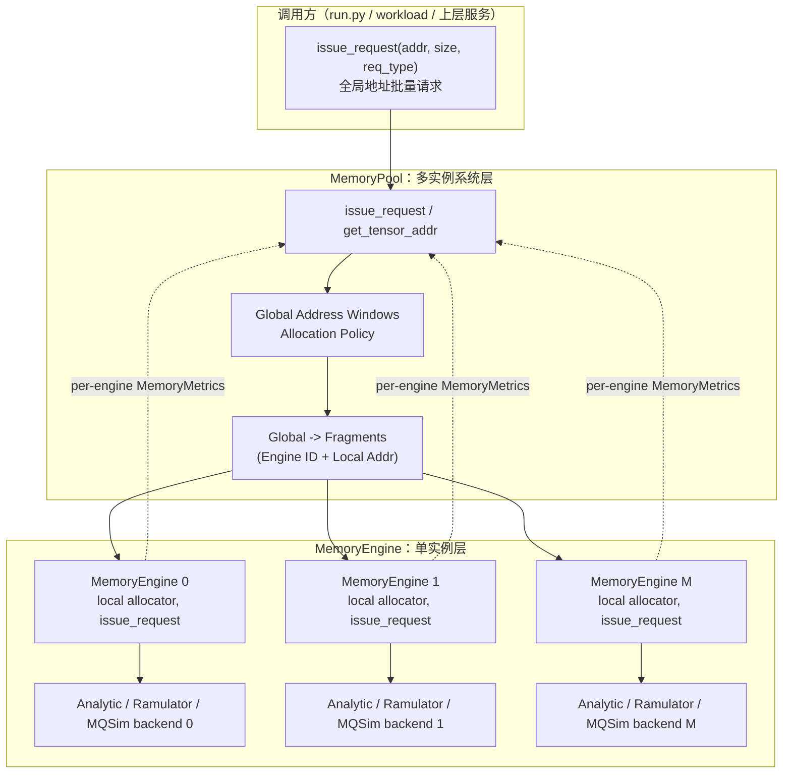

# 多实例管理设计方案

## 1. 文档目的

本文给出 MemEngine 多实例管理的设计：全局地址空间、实例路由与同步批量
执行。

目标是：

1. 将一个 `MemoryEngine` 明确定义为一个独立的物理介质实例。
2. 通过 `MemoryPool` 管理多个 `MemoryEngine`、全局地址和实例路由。
3. `MemoryPool` 接收调用者的全部请求，按地址窗口边界把每个请求切分后
   下发到各实例，由实例的同步 `issue_request()` 批量执行并聚合结果。
4. 单实例场景直接使用 `MemoryEngine.issue_request()`。

不考虑：

- Ramulator/MQSim 的跨调用竞争或在线增量仿真。
- 交错式 stripe（fragment 粒度跨实例交替放置）；顺序打包产生的
  窗口溢出延伸不在此列。
- 数据复制、迁移、remote request 或缓存一致性。
- PCIe switch、网络、计算单元等多级共享资源的精确流水和仲裁；实例间的
  并行只用「各实例独立、池级时间取 max」表达。

## 2. 核心设计结论

### 2.1 层级划分

- `MemoryEngine`：单个物理介质实例。local 地址分配、容量校验、backend
  生命周期、同步 `issue_request()` 与累计指标 `MemoryEngineMetrics`。
- `MemoryPool`：多实例地址和路由管理层。全局地址窗口、分配策略、
  global→local 转换、池级同步 `issue_request()` 路由与聚合。

### 2.2 职责划分

下列职责不属于 `MemoryEngine`：

- DP 请求复制。
- 实例数量管理。
- 跨实例分配与路由。
- 池级全局地址空间。
- 池级全局请求计数。

DP 语义应由上层 workload 或父项目服务拓扑表达；多实例数量、地址空间和
请求路由由 `MemoryPool` 表达。

### 2.3 地址语义

- 直接调用 `MemoryEngine` 时，地址是该实例的 local byte address。
- 通过 `MemoryPool` 调用时，地址始终是 pool global byte address。
- 根据 global address 所在的实例地址窗口按边界切分后确定性路由。
- 实例选择发生在数据分配时，而不是每次访问时，避免同一个地址被动态
  发送到不同实例。

## 3. 整体架构图



每个 Engine 独立调用自己的 backend。三个后端都工作于同步 batch 模式。
TODO(phase-2): POOL scope（共享带宽）。

## 4. 模块职责

| 模块 | 核心职责 | 不负责的内容 |
| --- | --- | --- |
| `MemoryEngine` | 单实例 local 地址分配、容量校验、backend 生命周期、同步 `issue_request()`、累计指标 | 多实例数量、跨实例路由、DP 复制 |
| `MemoryPool` | 实例集合、global 地址窗口、global→local 转换、池级 `issue_request()` 路由与聚合 | DRAM/NAND 细节、引擎内部 backend 调用 |

## 5. 多实例和地址空间设计

### 5.1 固定全局地址窗口

每个 MemEngine 分配一个互不重叠的 global address window。

假设实例容量为 `C0`、`C1`、`C2`：

```text
MemEngine 0: global [0,       C0)
MemEngine 1: global [C0,      C0+C1)
MemEngine 2: global [C0+C1,   C0+C1+C2)
```

对于实例 `i`：

```text
global_addr = global_base[i] + local_addr
local_addr  = global_addr - global_base[i]
```

实例可以通过对窗口起始地址进行二分查找，或在同构等容量时通过除法快速
定位。实现上优先使用统一的窗口表，以便以后支持异构容量。

### 5.2 地址分配

池级接口：

```python
def get_tensor_addr(self, size_bytes: int) -> int:
    """Allocate and return the global start address."""
```

分配策略为**顺序全局打包**：

1. 从全局水位 `global_addr`（各 engine 本地水位之和）取一段对齐后的
   连续全局区间 `[addr, addr + aligned)`。
2. 区间按窗口边界切成片段，逐片段调用对应
   `MemoryEngine.get_tensor_addr()` 分配 local address。打包不变量
   保证 engine 返回的本地地址与窗口偏移一致；不一致说明有调用方绕开
   pool 直接向 engine 1+ 分配，fail-loud 抛 `RuntimeError`（engine 0
   的 `global_base` 为 0，绕开 pool 的直接分配会被静默吸收）。
3. 返回全局起始地址。

因此一个 allocation 可以跨越多个实例窗口——前面的实例填满后才轮到
后面的实例。注意取舍：小 tensor 会依次堆满 engine 0，跨实例带宽聚合
主要靠大请求/大分配跨界获得，而不是靠放置摊开。

TODO(phase-2): 可插拔分配策略（LEAST_ALLOCATED、加权、段表条带化）。

### 5.3 地址访问校验

`MemoryPool.issue_request()` 对每个请求做校验（经 `_split_range`）：

- `addr >= 0`。
- `size_bytes > 0`。
- `[addr, addr + size_bytes)` 不超出池总容量。

跨界请求合法，会被切成多个窗口片段。

### 5.4 请求的实例归属由地址决定

MemoryPool 的策略是数据 placement 策略，而不是每次访问时
的负载均衡策略：

```text
一次 allocation      -> 一段连续全局地址（可跨多个 MemoryEngine 窗口）
一次 memory request  -> 按地址切分，落到覆盖该区间的若干 MemoryEngine
```

请求不会因为当前实例繁忙而动态发送到其他实例。只有后续显式支持
数据副本或迁移时，一个逻辑请求才可能路由到地址以外的存储节点。

### 5.5 介质带宽

每个 Engine 获得配置 `bandwidth` ÷ instance_count（GiB/s）——
`bandwidth` 按**总带宽**口径解释，`MemoryPoolConfig.__post_init__`
与容量一起均分。这是静态分摊：各实例独立、并行执行，N 实例模型
的聚合峰值约为配置带宽。均分目前只影响 Analytic 后端；
Ramulator/MQSim 的带宽由器件组织/仿真决定，不消费该字段。
不区分介质带宽和传输链路带宽——如需建模传输瓶颈，可调节配置的
bandwidth 值。

TODO(phase-2): 如果目标硬件需要按负载动态共享带宽，需引入 POOL
scope（共享带宽资源）。

## 6. 核心数据结构和接口

### 6.1 MemoryRequest — 统一请求类型

`MemoryRequest` 是一个逻辑访问的统一请求类型：

```python
@dataclass
class MemoryRequest:
    size: int                           # 字节数
    req_type: MemoryRequestType         # 读写类型
    addr: Optional[int] = None          # 地址
    media_req_num: int = 0              # 按 granularity 分解的估计数量
    media_request_list: List["MediaRequest"] = field(default_factory=list)
                                        # 分解后的介质请求（由 backend 填充）
```

构造签名为 `MemoryRequest(addr, size, req_type, *, config=None)`：传入
engine 的 config 时，`media_req_num` 按 `ceil(size / config.granularity)`
现算（未传 config 时按 64 B 粒度估算）。

### 6.2 Pool 配置与接口

多实例场景的统一配置入口是 `MemoryPoolConfig`：

```python
@dataclass
class MemoryPoolConfig:
    instance_count: int = 1          # 实例数量（>= 1）
    memory_type: MemoryType = MemoryType.HBM
    media_config: Optional[object] = None
    media_config: Optional[object] = None
                                     # capacity / bandwidth 均按总量
                                     # （GiB / GiB/s）解释
```

`MemoryPool(config)` 内部为每个实例派生 `MemoryEngineConfig`；窗口容量
按整 GiB 整除，余数归最后一个实例（除容量余数外各实例同构）。

```python
def issue_request(
    self,
    addr: List[int],               # 全局地址
    size: List[int],
    req_type: List[MemoryRequestType],
) -> MemoryMetrics:
    """每个请求按窗口边界切成一个或多个片段，各实例并行执行后聚合。"""
```

路由与聚合规则：

1. 逐请求 `_split_range(addr, size)` 按窗口边界切分，每个片段的全局
   地址减 `global_base` 得到 local address，按实例分组。
2. 每个实例用自己的 local 子批次调用 `engine.issue_request()`，各自
   累计 `MemoryEngineMetrics`。
3. 池级聚合（实例并行假设）：
   - `total_time` / `cycles` = 各实例最大值；
   - `memory_reqs_num` = 各实例求和（跨界请求的每个片段各计一次）；
   - `bandwidth = Σbytes / max_time`（精确重算）；
   - `iops`/`iops_read`/`iops_write` = 各实例非 None 值的平均值
     （全 None 则为 None）。IOPS 是单实例设备属性，池级不求和。

`get_tensor_addr` 返回全局起始地址；数据先通过它分配，
后续读写使用该全局地址。所属实例由地址窗口算术确定
（`bisect` 窗口基址表后减 `global_base`）。

其他辅助接口：

- `instances`（只读属性）：池中全部 `MemoryEngine` 实例组成的元组。
- `get_engine(engine_id) -> MemoryEngine`：按实例 id 取单个 engine，
  越界抛 `IndexError`。
- `align_up(size_bytes) -> int`：按对齐粒度向上取整。各实例同构、
  粒度一致，委托给第一个 engine 的同名方法。
- `reset_addr()`：把所有成员 engine 的分配水位清零（池全局水位 =
  各 engine 水位之和，无独立变量）。这是唯一合法的池级重置方式；
  单独重置某个成员 engine 会破坏打包不变量，导致地址复用或
  invariant 报错。
- `global_addr`（只读属性）：分配水位，即下一次分配的起始全局地址，
  等于各 engine 本地水位之和，对任意实例数都有确定语义。
- `total_capacity_bytes`（只读属性）：池总容量（各窗口容量之和）。

## 7. 指标设计

- 每个 Engine 只维护自己的 `MemoryEngineMetrics`（`issue_request` 的
  累计指标）。
- 池级单次结果是一个 `MemoryMetrics`，按 §6.2 的口径从各实例结果聚合，
  不额外维护池级累计计数器——需要池级累计时对各实例的
  `MemoryEngineMetrics` 再按同一口径聚合。

## 8. 配置语义

当前 JSON 配置（见 `configs/analytic_pool.json`）：

```json
{
  "mem_type": "HBM",
  "media_config": {
    "media_type": "analytic",
    "capacity": 4.0,
    "bandwidth": 400.0,
    "instances": 4
  }
}
```

`instances` 放在 `media_config` 中，缺省为 1。

关键语义：

- `capacity`：按**总容量**（GiB）解释。`MemoryPool` 构建时按整 GiB
  整除：前 n-1 个实例窗口各 ⌊total ÷ n⌋ GiB，余数（含不足 1 GiB
  的分数部分）全部归最后一个窗口（如 4 GiB ÷ 3 → 1/1/2 GiB；窗口
  不等时打 info 日志）。整 GiB 窗口边界必然按地址粒度对齐，容量
  无损失。第一个实例容量小于地址对齐粒度（整 GiB 整除下即份额
  不足 1 GiB）时抛 `ValueError`。
- `bandwidth`：按**总带宽**解释，`MemoryPoolConfig.__post_init__`
  ÷instances 均分给各实例。N 实例模型的聚合峰值约为配置带宽（各
  实例实得 bandwidth/N，并行执行）。均分目前只影响 Analytic 后端；
  Ramulator/MQSim 的带宽由器件组织/仿真决定，不消费该字段。
- 单实例口径：`MemoryEngineConfig` 的 `capacity` 即实例容量（字节）。

## 9. 测试方案

- `tests/test_memory_engine.py`：单实例回归（地址分配、对齐、容量溢出、
  同步 issue_request、累计指标）。
- `tests/test_memory_pool.py`：地址窗口、顺序打包与跨界分配、global↔local
  换算、跨界请求切分、池级聚合口径、空输入/长度不匹配/越界等无效输入。

## 10. 后续工作（phase-2 及以后）

- 可插拔分配策略（LEAST_ALLOCATED、加权等）。
- 异构实例（不同容量/带宽）。
- POOL scope 共享带宽资源。
- 跨实例交错 stripe（段表）/ 迁移 / 副本。

## 11. 最终边界

- `MemoryEngine` 不知道实例数量，不做跨实例路由。
- `MemoryPool` 不接触 DRAM/NAND 细节，不直接调用 media backend。
- 分配和请求以窗口边界为切分点；片段是 backend 可见的最小路由单位。
